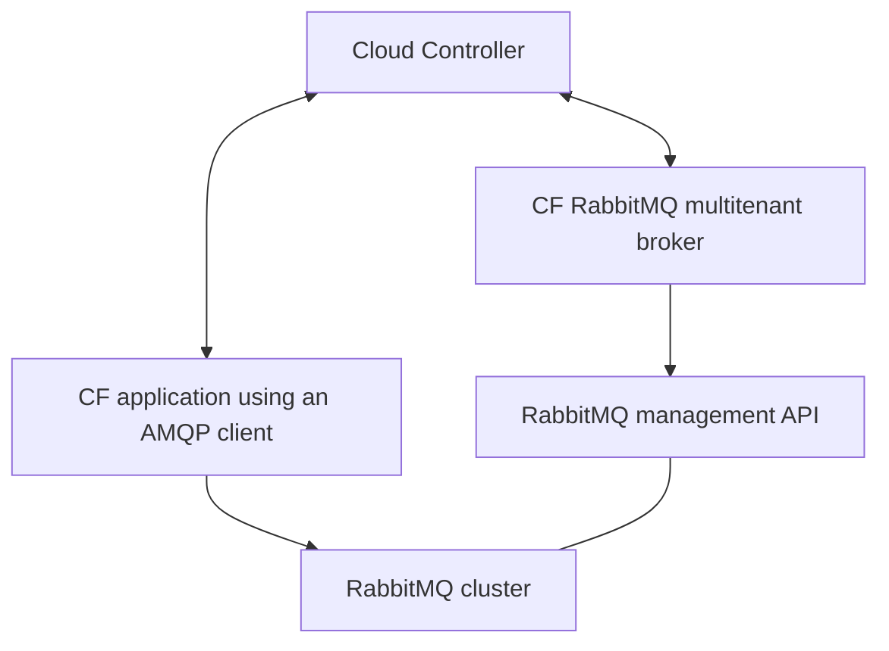

# RabbitMQ Service Broker

The RabbitMQ Genesis Kit includes support for deploying the Cloud Foundry RabbitMQ Multitenant Service Broker, which allows Cloud Foundry applications to use RabbitMQ as a managed service.

On RabbitMQ 4.x, the broker is deployable, and a live test deployed it, registered it with Cloud Foundry, and bound an app to a service instance. RabbitMQ 4.x removed classic queue mirroring in favor of quorum queues as the default queue type, and the broker's old default `ha-mode` policy targets classic mirrored queues, so the kit turns it off by default and prints a warning that says so each time it builds the manifest. Broader validation against quorum queue workloads is planned follow-up work.

## Overview

The service broker provides:

1. **Service Instance Management**
   The broker creates and deletes RabbitMQ vhosts (virtual hosts).

2. **Service Binding**
   The broker generates credentials and permissions for applications.

3. **Service Plans**
   Customizable service tiers carry different limits and policies.

4. **Integration with Cloud Foundry**
   The broker supplies marketplace listings and an instance dashboard.

## Architecture

When the `broker` feature is enabled, the Genesis Kit deploys:

1. **Broker VM**
   This VM runs the cf-rabbitmq-multitenant-broker service.

2. **Broker Database**
   This database stores service instance and binding information.

3. **Broker API**
   This HTTPS endpoint implements the Open Service Broker API.

4. **Service Dashboard**
   This web UI manages RabbitMQ service instances.

The broker interacts with the following:

- Cloud Foundry Cloud Controller
  The broker handles service registration and provisioning requests from it.

- RabbitMQ Management API
  The broker uses it to create vhosts, users, and permissions.

- Applications
  The broker delivers bindings and credentials to them.



## Enabling the Broker

To enable the broker, add the `broker` feature to your environment:

```yaml
# In your environment file (e.g., cf-rabbitmq.yml)
kit:
  features:
    - broker
```

### Required Parameters

The broker feature requires the following parameters:

```yaml
params:
  # Required broker parameters
  broker_domain: rabbitmq-broker.example.com
  cf_admin_client: rabbitmq-smoke-tests
```

The `cf_admin_client` parameter names the UAA client that the broker smoke tests use to log in to Cloud Foundry. The client needs the `client_credentials` grant and the `cloud_controller.admin` authority. Its secret is not a parameter. The broker feature declares it as a provided secret, so `genesis <env> add-secrets` prompts for it and stores it in Vault at `secret/<your/env>/rabbitmq/cf/admin-client:secret`. To set it without the Genesis prompt, write it yourself with the command below. Give `safe` the key name and no value, and it asks for the secret twice without echoing it, so the secret stays out of your shell history and the process list.

```
safe set secret/<your/env>/rabbitmq/cf/admin-client secret
```

### Optional Parameters

Customize the broker with these parameters:

```yaml
params:
  # Optional broker parameters with defaults shown
  broker_username: broker
  broker_network: rabbitmq
  broker_vm_type: small
  broker_name: p-rabbitmq
  service_name: p-rabbitmq
  operator_policy_enabled: false
  operator_policy_name: operator_set_policy
  operator_policy_definition: "{}"
  operator_policy_priority: 50
```

## Registering the Broker with Cloud Foundry

After deployment, register the broker with Cloud Foundry using the provided addon:

```bash
# Register the broker
genesis do my-env -- register-broker
```

This command does three things.

1. Authenticates with Cloud Foundry

2. Registers the broker using the configured parameters

3. Makes service plans available in the marketplace

## Using the Service

Applications can use the service through the standard CF service workflows:

```bash
# View service in marketplace
cf marketplace

# Create a service instance
cf create-service p-rabbitmq standard my-rabbit

# Bind to an application
cf bind-service my-app my-rabbit

# Check environment for credentials
cf env my-app
```

## Service Plans

The broker offers one service plan, named `standard`, whose ID is fixed in the kit's broker manifest. Each service instance on that plan gets its own vhost on the shared cluster, and each binding gets its own user with permissions on that vhost. The plan sets no resource limits, and it applies an operator policy only when `operator_policy_enabled` is on.

## Known Limitations

Two limitations affect the management entries in service bindings and service keys.

**Management host and certificate**. The `management` entries in a binding name the host that the broker is given for the cluster, which in this kit is the HAProxy address. The management certificate carries the names `rabbitmq-mgmt` and `params.mgmt_domain`, and it carries the HAProxy address only when `params.proxy_static_ip` is set. A client that verifies TLS against the host in the binding therefore fails unless you set `params.proxy_static_ip` and rotate the management certificate with `genesis <env> rotate-secrets --update-subjects -y mgmt/certs/server`, or the client overrides the name it verifies and uses `rabbitmq-mgmt`.

**No management TLS behind route-registrar**. The `no-mgmt-tls` feature makes the broker write `http` URIs for the management API, and it appends the plain management port 15672 to `params.mgmt_domain`. With `route-registrar` on as well, `params.mgmt_domain` is the Cloud Foundry router name, and the router terminates TLS on port 443 and does not serve port 15672. The `http_api_uri` and `http_api_uris` entries in a binding then point at `http://<router name>:15672`, which does not answer. We have not tested the combination of `broker`, `no-mgmt-tls`, and `route-registrar`, and we recommend that you keep management TLS on when you use `route-registrar` with the broker.

## TLS Configuration

By default, the broker serves HTTPS on port 4566. To disable TLS for the broker, add the `no-broker-tls` feature:

```yaml
kit:
  features:
    - broker
    - no-broker-tls
```

**Warning:** This is not recommended for production deployments.

## Custom Certificates

To use custom certificates for the broker, add the `provided-broker-cert` feature:

```yaml
kit:
  features:
    - broker
    - provided-broker-cert
```

Then, provide your certificates in Vault:

```bash
# Store custom broker certificate and key
safe set secret/my-env/rabbitmq/broker/certs/server certificate@cert.pem key@key.pem
```

## Route Registration

To expose the broker through Cloud Foundry's routing tier, add the `route-registrar` feature:

```yaml
kit:
  features:
    - broker
    - route-registrar
```

This registers routes with the CF GoRouter, making the broker and management UI accessible through CF domains.

## Metrics Emission

To enable metrics from RabbitMQ to be sent to Cloud Foundry's Loggregator, add the `metrics-emitter` feature:

```yaml
kit:
  features:
    - broker
    - metrics-emitter
```

## Troubleshooting

### Common Issues

1. **Broker Registration Fails**

   - Check connectivity between the broker and the CF API.

   - Verify the CF credentials and permissions.

   - Check the broker logs on the broker VM, in `/var/vcap/sys/log/rabbitmq-service-broker`, with `genesis my-env bosh ssh rmq-broker/0 -c "sudo bash -c 'tail -n 200 /var/vcap/sys/log/rabbitmq-service-broker/*.log'"`.

2. **Service Creation Fails**

   - Check the broker logs for errors.

   - Verify connectivity to the RabbitMQ management API.

   - Check that RabbitMQ has capacity for new vhosts.

3. **Service Binding Fails**

   - Check the broker logs for errors.

   - Verify the RabbitMQ user creation permissions.

   - Check that the vhost exists and is healthy.

### Diagnostic Commands

```bash
# Check broker status
genesis my-env bosh ssh rmq-broker/0 -c "sudo monit summary"

# Check broker logs
genesis my-env bosh ssh rmq-broker/0 -c "sudo bash -c 'tail -n 200 /var/vcap/sys/log/rabbitmq-service-broker/*.log'"

# Test the broker API locally. The broker listens on plain HTTP at 127.0.0.1:4567,
# so the call needs no CA file. The password comes from a prompt.
genesis my-env bosh ssh rmq-broker/0
read -rsp 'Broker password: ' BROKER_PASSWORD; echo
curl -sS -K <(printf 'user = "broker:%s"\n' "$BROKER_PASSWORD") http://localhost:4567/v2/catalog
unset BROKER_PASSWORD
```

To test the connection to RabbitMQ from the broker VM, we need the management CA. The server VMs hold it at `/var/vcap/jobs/rabbitmq-server/etc/management-cacert.pem`, and the broker VM does not, so we save the certificate from Vault at `secret/<your/env>/rabbitmq/mgmt/certs/ca:certificate` to a file on the broker VM, then call the management API through the HAProxy address with that file. The management certificate carries the name `rabbitmq-mgmt`, so `--resolve` lets curl verify that name while it connects to the address. The credentials come from a prompt, as above.

```bash
read -rp 'Management user: ' MGMT_USER
read -rsp 'Management password: ' MGMT_PASSWORD; echo
curl -sS --cacert ./mgmt-ca.pem --resolve rabbitmq-mgmt:15671:<haproxy-address> -K <(printf 'user = "%s:%s"\n' "$MGMT_USER" "$MGMT_PASSWORD") https://rabbitmq-mgmt:15671/api/overview
unset MGMT_USER MGMT_PASSWORD
```

## Advanced Configuration

### Custom Service Plans

The broker release builds its catalog in code, with the single `standard` plan, so the kit cannot add or change plans. To offer different plans, we would need a change to the broker release itself.

### Operator Policy

RabbitMQ 4.x removed classic queue mirroring, so the broker no longer sets an `ha-mode` policy. To have it set an operator policy on the vhosts it creates, enable one and give a definition that RabbitMQ 4.x accepts.

```yaml
params:
  operator_policy_enabled: true
  operator_policy_definition: '{"dead-letter-exchange":"dlx"}'
```
